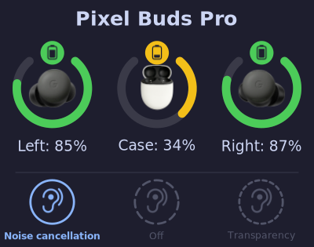
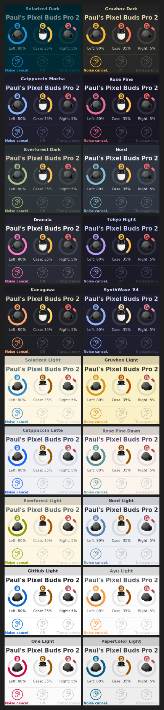

# pbwatch

**Your Pixel Buds on Linux, properly.**

pbwatch runs quietly in the background and pops up a desktop notification whenever your Pixel Buds battery changes or you switch ANC mode. No phone needed.



- Battery levels for left bud, right bud, and case
- Active ANC mode (Noise Cancellation, Off, Transparency, Adaptive)
- 20 built-in colour themes — or bring your own
- Monitors multiple pairs simultaneously
- Self-contained binary, no icon theme packages required

## Supported devices

| Model | Battery | ANC mode |
|---|---|---|
| Pixel Buds Pro 2 (2024) | ✓ | ✓ |
| Pixel Buds Pro (2022) | ✓ | ✓ |
| Pixel Buds A-Series (2021) | ✓ | — |
| Pixel Buds (2020) | untested | untested |
| Pixel Buds (2017, wired) | ✗ | ✗ |

✓ confirmed · — hardware doesn't support this · ✗ not supported · untested = reports welcome

## Install

**Requirements:** Rust (compiler), BlueZ (already installed on most distros), a notification daemon (dunst, mako, SwayNC, GNOME, KDE…).

**Install Rust** — use your distro's package if available, otherwise the official installer:

```bash
# Debian/Ubuntu
sudo apt install rustup && rustup default stable

# Fedora
sudo dnf install rust cargo

# Arch
sudo pacman -S rust

# Any distro — official installer (last resort)
curl --proto '=https' --tlsv1.2 -sSf https://sh.rustup.rs | sh
```

Full instructions: [rust-lang.org/tools/install](https://www.rust-lang.org/tools/install)

```bash
git clone https://github.com/yom/pbwatch.git
cd pbwatch
./install.sh --mac AB:CD:EF:01:23:45
```

Replace `AB:CD:EF:01:23:45` with your earbuds' Bluetooth address. To find it:

```bash
bluetoothctl devices
```

The script compiles the program, installs it, and starts the background service. The MAC address is saved to `~/.config/pbwatch/config.toml`.

**To update**, just run `./install.sh` again from the cloned directory — the MAC address is kept from the config.

### Multiple pairs

Repeat `--mac` for each pair:

```bash
./install.sh --mac AB:CD:EF:01:23:45 --mac 12:34:56:78:9A:BC
```

You can also add pairs later by editing `~/.config/pbwatch/config.toml`:

```toml
macs = ["AB:CD:EF:01:23:45", "12:34:56:78:9A:BC"]
```

Then restart: `systemctl --user restart pbwatch`

### Audio doesn't switch to the earbuds automatically?

Add `--heal-audio` to the install command:

```bash
./install.sh --mac AB:CD:EF:01:23:45 --heal-audio
```

Each time the earbuds connect, pbwatch will switch the Bluetooth card to the A2DP (high-quality audio) profile and set it as the default audio output. Useful if Linux stays on the HFP (phone call) profile instead.

This requires two extra packages:

```bash
sudo apt install pulseaudio-utils wireplumber
```

## Customisation

All configuration lives in `~/.config/pbwatch/config.toml`. Edit it at any time; restart pbwatch to apply:

```bash
systemctl --user restart pbwatch
```

| Setting | Default | Description |
|---|---|---|
| `macs` | *(required)* | List of Pixel Buds Bluetooth addresses, e.g. `["AB:CD:EF:01:23:45"]` |
| `heal_audio` | `false` | Switch to A2DP (high-quality audio) profile on each connect |
| `device_label` | *(empty)* | Name shown at the top of the widget. Defaults to the Bluetooth device name |
| `theme` | *(none)* | Named colour theme, e.g. `"Nord"`, `"Dracula"`. Overrides the colour fields below |
| `bg_color` | `"#1e1e2e"` | Background colour |
| `text_color` | `"#cdd6f4"` | Text colour |
| `highlight_color` | `"#89b4fa"` | Gauge arc colour (normal) and active ANC mode |
| `warn_color` | `"#f9e2af"` | Gauge arc colour below `battery_warn` |
| `critical_color` | `"#f38ba8"` | Gauge arc colour below `battery_critical` |
| `ring_color` | `"#ffffff20"` | Battery gauge track colour (8-digit hex = with transparency) |
| `opacity` | `0.0` | Background opacity: `0.0` = transparent, `1.0` = solid |
| `auto_close` | `5000` | How long the notification stays on screen, in milliseconds (0 = until dismissed) |
| `image_size` | `200` | Widget width in pixels |
| `font_size` | `100` | Font size as a percentage of normal (e.g. `120` = 20% larger) |
| `show_text` | `false` | Include battery/ANC text alongside the image in notifications |
| `battery_warn` | `50` | Gauge turns to `warn_color` below this percentage |
| `battery_critical` | `10` | Gauge turns to `critical_color` below this percentage |
| `anc_adaptive` | `"auto"` | Show Adaptive ANC button: `"auto"` (device-reported), `"true"` (always), `"false"` (never) |
| `sprite_set` | *(auto)* | Force sprite sheet: `"default"`, `"pro"`, `"pro2"`, `"a-series"` |

## Themes

Set `theme = "Nord"` (or any name below) in your config to switch colour schemes instantly.

The three battery gauges show the three colour states: left at 80% (`highlight_color`), case at 35% (`warn_color`), right at 5% (`critical_color`).



## Troubleshooting

**The notification stops showing up.**

```bash
systemctl --user status pbwatch
journalctl --user -u pbwatch -n 30
```

**The notification shows text but no image.**

See [`docs/notification-daemons/`](docs/notification-daemons/) for dunst, mako, and SwayNC setup.

## Contributing

Bug reports, compatibility reports, and feature requests are welcome on the [GitHub Issues](https://github.com/yom/pbwatch/issues) page.

**Compatibility reports are especially helpful** for models listed as *untested* above, and to confirm the Model ID of the Pixel Buds Pro 2. To include useful diagnostic info in a report:

```bash
journalctl --user -u pbwatch -f
```

Then connect your earbuds and paste the first few lines into your issue.
